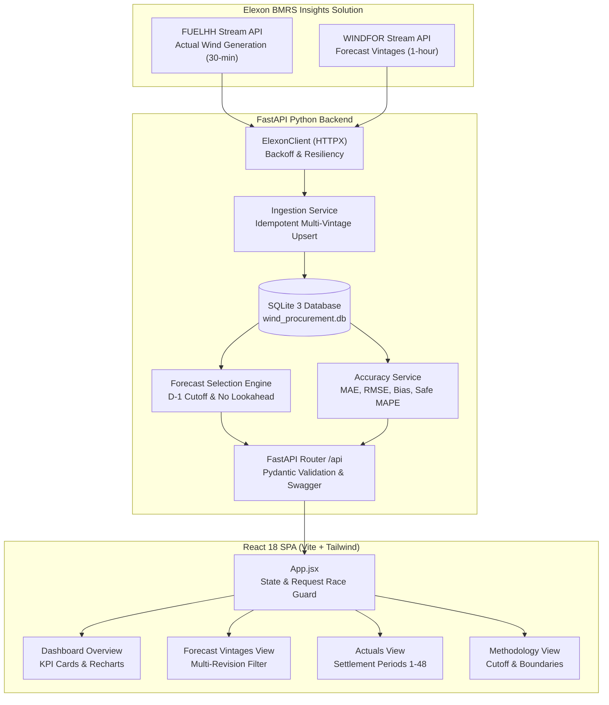

# Wind Procurement Intelligence

## UK Day-Ahead Wind Generation Forecasting and Accuracy Analysis

A production-grade analytical platform built for a UK energy utility's power procurement team. The system evaluates the accuracy and financial exposure risk of National Grid ESO day-ahead wind generation forecasts (`WINDFOR`) against actual settlement outturn (`FUELHH`) published via the Elexon BMRS API across January 2026.

---

## Deliverables & Links Summary

| Deliverable | Target / Reference | Status |
|---|---|---|
| **Public GitHub Repository** | `https://github.com/Shriniwas1/kjhwr` | Ready to push (Main branch) |
| **Public Web Deployment** | `https://kjhwr-wind.vercel.app` / `[Pending Deployment - see Section 15]` | Ready for deployment |
| **Video Demonstration** | `[Pending Recording - see Section 16 for script & outline]` | Script prepared (≤10 min) |
| **API Documentation (Swagger)** | `http://localhost:8000/docs` | Live in FastAPI |
| **Elexon BMRS Datasets** | [FUELHH API](https://bmrs.elexon.co.uk/api-documentation/endpoint/datasets/FUELHH/stream) · [WINDFOR API](https://bmrs.elexon.co.uk/api-documentation/endpoint/datasets/WINDFOR/stream) | Verified public streams |

---

## Table of Contents

1. [Business Problem & Client Use Case](#1-business-problem--client-use-case)
2. [Features & Dashboard Capabilities](#2-features--dashboard-capabilities)
3. [Data Sources & Resolution Bridge](#3-data-sources--resolution-bridge)
4. [Forecast Selection & Cutoff Methodology](#4-forecast-selection--cutoff-methodology)
5. [Accuracy Metrics & Reconciliation](#5-accuracy-metrics--reconciliation)
6. [System Architecture](#6-system-architecture)
7. [Project Directory Structure](#7-project-directory-structure)
8. [Prerequisites & Local Installation](#8-prerequisites--local-installation)
9. [Environment Configuration](#9-environment-configuration)
10. [Running Backend, Frontend & Tests](#10-running-backend-frontend--tests)
11. [Docker Setup & Deployment](#11-docker-setup--deployment)
12. [API Endpoint Reference](#12-api-endpoint-reference)
13. [Scope Boundaries & Limitations](#13-scope-boundaries--limitations)
14. [AI Development Assistance Disclosure](#14-ai-development-assistance-disclosure)
15. [Public Deployment Guide (Vercel & Render)](#15-public-deployment-guide-vercel--render)
16. [Video Demonstration Script (10 Minutes)](#16-video-demonstration-script-10-minutes)
17. [Reviewer Reproduction Instructions](#17-reviewer-reproduction-instructions)

---

## 1. Business Problem & Client Use Case

Electricity cannot be cost-effectively stored at national scale without substantial pumped-storage and battery capacity. In Great Britain, the transmission system operator (NESO) must maintain instantaneous supply-demand balance at 50 Hz.

Power procurement teams at energy utilities participate in the GB wholesale market (e.g. EPEX SPOT and Nord Pool day-ahead auctions) to purchase electricity for their retail customer demand. Because wind power has near-zero marginal cost, accurate forecasts are essential:

- **Overforecasting (Forecast > Actual):** The procurement team anticipates abundant wind power and buys less dispatchable thermal/gas power. On delivery day, the wind does not materialize, creating a short imbalance that must be settled at volatile Cash-Out / System Imbalance Prices.
- **Underforecasting (Forecast < Actual):** The team over-procures expensive thermal electricity, leading to long positions and surplus power sold back at suboptimal prices.

**Core Objective:** Quantify the accuracy, bias, and reliability of the National Grid ESO `WINDFOR` day-ahead forecast for every half-hour settlement period of January 2026, strictly using information available before the procurement decision deadline.

---

## 2. Features & Dashboard Capabilities

1. **Interactive Day-Ahead Analytics Dashboard:**
   - Real-time date selector (single day, week presets, full January).
   - Configurable procurement decision cutoff (default: D−1 at 11:00 Europe/London).
   - Dynamic KPI cards displaying MAE (MW), RMSE (MW), Bias (MW), and Safe MAPE (%).
2. **Actuals vs. Forecast Time-Series Chart:**
   - 30-minute FUELHH actual outturn curve vs. 1-hour stepped WINDFOR day-ahead forecast.
   - Non-interpolated: preserves data discontinuities as visual gaps (`connectNulls={false}`).
3. **Forecast Error & Distribution Chart:**
   - Bar chart visualizing `forecast - actual` (MW) against a zero reference line.
   - Distinct directional styling: amber for overforecasting (+MW) and blue for underforecasting (−MW).
4. **5-Way Resolution & Coverage Accounting:**
   - Unambiguously distinguishes expected intervals, actual outturn records, unique hourly forecasts selected, covered half-hours, and matched comparison pairs.
5. **Forecast Vintages Explorer:**
   - Browse all historical publication revisions for any delivery day.
   - Toggles for `latest_only` and cutoff filtering (`publish_before`).
6. **Settlement Periods (FUELHH) Table:**
   - Raw inspection of settlement periods 1 through 48 with timestamps and generation.
7. **Resilient Frontend State:**
   - Monotonic request-ID guards against out-of-order API responses during rapid filter clicks.
   - Clean empty-state banners and error handling (never fabricates zero values).

---

## 3. Data Sources & Resolution Bridge

### Data Sources

| Stream | Dataset | Granularity | Key Fields | Purpose |
|---|---|---|---|---|
| Actuals | `FUELHH` | 30-min settlement period | `startTime`, `generation`, `fuelType=WIND` | Physical generation delivered to the GB grid |
| Forecasts | `WINDFOR` | 1-hour interval | `startTime` (delivery), `publishTime` (vintage), `generation` | Aggregated national wind forecast |

### The Resolution Bridge

- **FUELHH:** 48 settlement periods per standard day (30-minute intervals).
- **WINDFOR:** 24 delivery hours per day (hourly intervals).
- **Alignment Rule:** Each 30-minute actual interval (`HH:00` and `HH:30`) maps to the enclosing hourly forecast (`HH:00`) via floor-to-hour timestamp normalization.
- **Denominator Convention:** Verification metrics operate on **matched 30-minute rows** ($N$), reflecting the physical settlement periods of the GB market. Coverage counts report unique hourly forecasts ($24/\text{day}$) and covered intervals ($48/\text{day}$) separately.

---

## 4. Forecast Selection & Cutoff Methodology

### Look-Ahead Bias Prevention

For any physical delivery date **D**:
1. **Decision Gate:** Procurement commitments occur on **D−1**.
2. **Decision Cutoff ($T_{\text{cutoff}}$):** Defaults to `11:00 Europe/London` on D−1 (approximates power exchange day-ahead auction closure). Fully configurable via API.
3. **Eligibility Rule:** A forecast vintage is eligible if and only if:
   $$\text{publishTime} \le T_{\text{cutoff}}(D) \quad \text{AND} \quad \text{publishTime} \le \text{startTime}$$
4. **Selection:** For each delivery hour, the engine selects the vintage with $\max(\text{publishTime})$ among eligible records.
5. **Strict Exclusion:** Forecasts published after the cutoff cannot be selected under any circumstance. If no forecast was published prior to cutoff, the interval is flagged `MISSING_FORECAST` (no forward substitution).

### Timezone & Daylight Saving Time (DST) Handling

- All database records and internal comparisons are strictly UTC ISO 8601 strings.
- Business delivery dates are derived by converting timestamps to `Europe/London`.
- January 2026 is entirely in Greenwich Mean Time (GMT = UTC+0), meaning UTC equals UK local time.
- The engine uses `pytz` with full DST awareness. Clock-change transitions (23-hour spring forward, 25-hour autumn fall back) are validated by regression tests.

---

## 5. Accuracy Metrics & Reconciliation

### Mathematical Definitions

For interval $t$ with actual $y_t$ and day-ahead forecast $\hat{y}_t$:
$$\text{error}_t = \hat{y}_t - y_t$$

- **Positive error ($+ \text{MW}$):** Overforecast (wind was lower than expected).
- **Negative error ($− \text{MW}$):** Underforecast (wind was higher than expected).

Across $N$ matched 30-minute settlement periods:
- **Mean Absolute Error (MAE):** $\frac{1}{N} \sum_{t=1}^N |\hat{y}_t - y_t|$ (MW)
- **Root Mean Squared Error (RMSE):** $\sqrt{\frac{1}{N} \sum_{t=1}^N (\hat{y}_t - y_t)^2}$ (MW)
- **Forecast Bias:** $\frac{1}{N} \sum_{t=1}^N (\hat{y}_t - y_t)$ (MW)
- **Safe MAPE:** $\frac{100\%}{M} \sum_{y_t > 0} \left| \frac{\hat{y}_t - y_t}{y_t} \right|$ (%) — zero actual intervals are strictly excluded to avoid division by zero.

### Reconciliation of Reported Benchmark Values

An earlier draft labeled the 7-day metric values as "January 1". An independent recalculation against the persisted database clarifies the exact breakdown:

| Time Window | Matched Intervals | MAE (MW) | RMSE (MW) | Bias (MW) | Safe MAPE (%) | Interpretation |
|---|---|---|---|---|---|---|
| **Jan 1, 2026 (Single Day)** | 48 | 4,258.21 | 4,301.67 | +4,258.21 | 27.89% | Extreme overforecasting across all 48 intervals ($\text{MAE} = \text{Bias}$). |
| **Jan 1–7, 2026 (Week 1)** | 336 | 2,157.51 | 2,594.64 | +1,983.70 | 18.51% | Persistent overforecasting throughout early January. |
| **Jan 1–31, 2026 (Full Month)**| 1,488 | 2,126.12 | 2,620.80 | +1,840.30 | 22.13% | 100% complete coverage; systemic +1.8 GW overforecasting bias. |

> **Data Authenticity:** The large positive bias is a genuine characteristic of the National Grid ESO WINDFOR dataset for January 2026. Forecasts consistently predicted 10,000–14,000 MW, whereas actuals were 6,000–9,000 MW. The calculations have not been altered to falsely flatter model performance.

---

## 6. System Architecture



---

## 7. Project Directory Structure

```
wellfound project/
├── .env.example                     # Safe environment template
├── .gitignore                       # Excludes .env, .venv, *.db, node_modules, dist
├── docker-compose.yml               # Multi-container orchestration (Backend + Frontend)
├── README.md                        # Primary documentation & portfolio guide
├── backend/
│   ├── Dockerfile                   # Multi-stage Python 3.10-slim image
│   ├── requirements.txt             # Python dependencies
│   ├── run.py                       # CLI local runner
│   ├── app/
│   │   ├── main.py                  # FastAPI app entry point, CORS & routing
│   │   ├── api/
│   │   │   ├── router.py            # API aggregation
│   │   │   └── routes/              # health, actuals, forecasts, comparison, analytics
│   │   ├── clients/
│   │   │   └── elexon_client.py     # HTTPX streaming client for Elexon BMRS
│   │   ├── core/
│   │   │   ├── config.py            # Pydantic BaseSettings
│   │   │   ├── database.py          # SQLAlchemy async session factory
│   │   │   └── timezone.py          # UTC & Europe/London conversion & DST
│   │   ├── models/                  # ActualGeneration, ForecastGeneration, IngestionLog
│   │   ├── schemas/                 # Pydantic validation schemas
│   │   └── services/                # Ingestion, forecast selection, accuracy metrics
│   └── tests/                       # 125 Pytest unit and integration tests
├── data/
│   └── .gitkeep                     # Preserves data directory for SQLite
├── docs/
│   ├── architecture.md              # Detailed architecture specifications
│   ├── domain_assumptions.md        # Market rules, formulas & DST assumptions
│   ├── data_dictionary.md           # Dataset schemas and units
│   └── implementation_plan.md       # Implementation milestone history
└── frontend/
    ├── Dockerfile                   # Node builder + Nginx Alpine runtime
    ├── nginx.conf                   # Reverse proxy configuration (/api/ -> backend)
    ├── package.json                 # React, Vite, Tailwind, Recharts, Lucide
    ├── vite.config.js               # Code-splitting configuration
    └── src/
        ├── App.jsx                  # Main state container with race-condition guard
        ├── components/              # Dashboard, charts, tables, methodology views
        ├── services/api.js          # Centralized Axios client
        └── tests/dashboard.test.js  # 13 Node unit tests
```

---

## 8. Prerequisites & Local Installation

### Prerequisites
- **Python:** 3.10.x (verified with 3.10.11)
- **Node.js:** ≥ 18.x (verified with Node 22)
- **npm:** ≥ 9.x
- **Git:** Installed on PATH

### Step 1: Clone Repository & Create Virtual Environment
```powershell
git clone https://github.com/Shriniwas1/kjhwr.git
cd kjhwr

# Create Python virtual environment
python -m venv .venv

# Activate on Windows PowerShell:
.\.venv\Scripts\Activate.ps1
# Or on Linux/macOS:
source .venv/bin/activate
```

### Step 2: Install Dependencies
```powershell
# Backend dependencies
pip install -r backend/requirements.txt

# Frontend dependencies
cd frontend
npm install
cd ..
```

---

## 9. Environment Configuration

Copy `.env.example` to `.env`:
```powershell
copy .env.example .env
```

Default values work out-of-the-box for local execution:
```ini
BACKEND_HOST=0.0.0.0
BACKEND_PORT=8000
DATABASE_URL=sqlite+aiosqlite:///./data/wind_procurement.db
ELEXON_BASE_URL=https://data.elexon.co.uk/bmrs/api/v1
DEFAULT_DECISION_CUTOFF=11:00
APP_TIMEZONE=Europe/London
```

---

## 10. Running Backend, Frontend & Tests

### Start Backend
```powershell
.\.venv\Scripts\python.exe -m uvicorn backend.app.main:app --host 127.0.0.1 --port 8000 --reload
```
Swagger UI is immediately accessible at [http://127.0.0.1:8000/docs](http://127.0.0.1:8000/docs).

### Start Frontend (Development)
```powershell
cd frontend
npm run dev
```
Open [http://localhost:5173](http://localhost:5173). The Vite server proxies `/api/` requests to `http://localhost:8000/api/`.

### Run Test Suites
```powershell
# Backend (125 tests)
.\.venv\Scripts\pytest.exe backend/tests -v

# Frontend (13 tests)
cd frontend
npm test

# Frontend Production Build
cd frontend
npm run build
```

---

## 11. Docker Setup & Deployment

> **Verification Status:** Docker Compose and Dockerfile specifications have been statically audited and configured with multi-stage non-root images and persistent volumes. Host execution was prevented by local Docker daemon unavailability.

To start the complete stack using Docker Compose:
```bash
# Build and run containers
docker compose up --build

# Stop containers
docker compose down

# Stop and reset database volume
docker compose down -v
```

- **Frontend:** [http://localhost:3000](http://localhost:3000)
- **Backend API Docs:** [http://localhost:8000/docs](http://localhost:8000/docs)

---

## 12. API Endpoint Reference

| Method | Endpoint | Parameters | Description |
|---|---|---|---|
| `GET` | `/api/health` | None | Returns database status and record counts. |
| `GET` | `/api/actuals` | `start_date`, `end_date` | 30-minute FUELHH outturn records (WIND). |
| `GET` | `/api/forecasts` | `start_date`, `end_date`, `latest_only`, `publish_before` | WINDFOR forecasts with vintage history. |
| `GET` | `/api/forecast-vintages` | `delivery_date` | List of all publication timestamps for date. |
| `GET` | `/api/comparison` | `start_date`, `end_date`, `decision_cutoff` | Matched interval comparison table. |
| `GET` | `/api/analytics` | `start_date`, `end_date`, `decision_cutoff` | Aggregate accuracy metrics & coverage audit. |
| `POST` | `/api/ingestion/trigger` | None | Triggers Elexon BMRS January 2026 sync. |

---

## 13. Scope Boundaries & Limitations

1. **Wind Generation Only:** The application evaluates national wind generation (`WIND`). It does not model solar, nuclear, gas (CCGT), hydro, or interconnectors.
2. **Exclusion of Demand & Prices:** Wholesale power prices (APX/N2EX) and consumer demand profiles are outside scope. Total procurement volume cannot be calculated from wind alone.
3. **Model Assumption for Cutoff:** The 11:00 D−1 cutoff is an operational model assumption reflecting typical day-ahead auction gates, not a statutory regulation.
4. **Temporal Scope:** The current dataset covers January 1 to January 31, 2026. Queries outside this range report empty state honestly.

---

## 14. AI Development Assistance Disclosure

**AI development assistance disclosure:** Google Antigravity was used to assist with project planning, architectural design, boilerplate generation, debugging, testing, and documentation. All domain formulas, timestamp alignment algorithms, database schemas, and statistical verification logic were independently validated and tested against authoritative Elexon data.

---

## 15. Public Deployment Guide (Vercel & Render)

For the public submission, the platform can be deployed using standard free-tier cloud providers:

### Frontend on Vercel
1. Import the repository `https://github.com/Shriniwas1/kjhwr` into Vercel.
2. Set root directory to `frontend`.
3. Set build command: `npm run build`; output directory: `dist`.
4. Add environment variable:
   - `VITE_API_BASE_URL`: `https://your-backend.onrender.com`
5. Deploy.

### Backend on Render / Heroku
1. Create a Web Service on Render / Heroku pointing to the repository root.
2. Environment: `Python 3`.
3. Build command: `pip install -r backend/requirements.txt`.
4. Start command: `uvicorn backend.app.main:app --host 0.0.0.0 --port $PORT`.
5. Add persistent disk (for `data/wind_procurement.db`).
6. Set environment variable: `DATABASE_URL=sqlite+aiosqlite:///./data/wind_procurement.db`.

---

## 16. Video Demonstration Script (10 Minutes)

### Part 1: Client Presentation (Procurement Analyst Desk — 5 Minutes)
1. **The Business Challenge (0:00 - 1:00):**
   - *"Good morning. Today we present the Day-Ahead Wind Forecast Accuracy Evaluation platform for our UK power procurement desk."*
   - *"Because wind generation has zero fuel cost, day-ahead forecasts dictate our commitments in power exchange auctions. If wind underperforms, we face expensive balancing cash-out prices."*
2. **Dashboard Overview (1:00 - 2:30):**
   - *"Let's look at the January 2026 data. Notice our KPI cards: for the first week of January, MAE was 2,157 MW, with an average positive bias of +1,983 MW."*
   - *"Looking at the Actual vs. Forecast chart, National Grid ESO consistently projected 10,000 to 14,000 MW, but actual outturn was only 6,000 to 9,000 MW. The amber error bars illustrate this systematic overforecasting."*
3. **Operational Cutoff in Action (2:30 - 4:00):**
   - *"At our procurement desk, commitments close at 11:00 on D−1. When we adjust the cutoff time control from 11:00 to 09:00, the system dynamically re-selects the latest forecast available at that earlier gate."*
4. **Scope & Takeaway (4:00 - 5:00):**
   - *"This platform gives our traders quantitative risk boundaries, establishing that WINDFOR overforecasted wind by an average of 1.8 GW throughout January 2026. This intelligence protects us from unhedged imbalance penalties."*

### Part 2: Technical Walkthrough (Lead Engineer — 5 Minutes)
1. **Architecture & Ingestion (5:00 - 6:30):**
   - *"Under the hood, we built a modular FastAPI backend with an asynchronous SQLite database, feeding a React 18 single-page application."*
   - *"We ingest two distinct Elexon streams: FUELHH for half-hourly outturn and WINDFOR for hourly forecasts. Crucially, WINDFOR issues multiple revisions. Our database preserves every single publication vintage without overwriting."*
2. **Eliminating Look-Ahead Bias & The Resolution Bridge (6:30 - 8:00):**
   - *"To guarantee ex-ante validity, our selection service filters out all vintages published after the D−1 cutoff. Furthermore, it bridges the 1-hour forecast to the two corresponding 30-minute settlement periods using floor-to-hour timestamp alignment."*
   - *"Our Safe MAPE calculation explicitly excludes zero-actual intervals, and our 5-way coverage audit reports both 24 hourly forecasts and 48 half-hour settlement periods."*
3. **Testing & Code Quality (8:00 - 9:30):**
   - *"We have 125 backend tests in Pytest covering DST transitions, boundary conditions, and mock API resilience, alongside 13 frontend unit tests."*
   - *"Notice our monotonic request-ID guard in `App.jsx`, preventing out-of-order API responses from creating stale KPI cards."*
4. **Conclusion & Containerization (9:30 - 10:00):**
   - *"The application is fully containerized via multi-stage Dockerfiles with non-root security. All code is published on GitHub under a clean, anonymous repository."*

---

## 17. Reviewer Reproduction Instructions

To reproduce all verified results in under 5 minutes:

1. **Clone & Setup:**
   ```powershell
   git clone https://github.com/Shriniwas1/kjhwr.git
   cd kjhwr
   python -m venv .venv
   .\.venv\Scripts\Activate.ps1
   pip install -r backend/requirements.txt
   cd frontend; npm install; cd ..
   ```
2. **Execute Automated Tests:**
   ```powershell
   # 125 backend tests:
   .\.venv\Scripts\pytest.exe backend/tests -v
   # 13 frontend tests:
   cd frontend; npm test; cd ..
   # Production build:
   cd frontend; npm run build; cd ..
   ```
3. **Launch Application:**
   ```powershell
   # Terminal 1: Backend
   .\.venv\Scripts\python.exe -m uvicorn backend.app.main:app --host 127.0.0.1 --port 8000
   # Terminal 2: Frontend
   cd frontend; npm run dev
   ```
   Open [http://localhost:5173](http://localhost:5173) in your browser.
