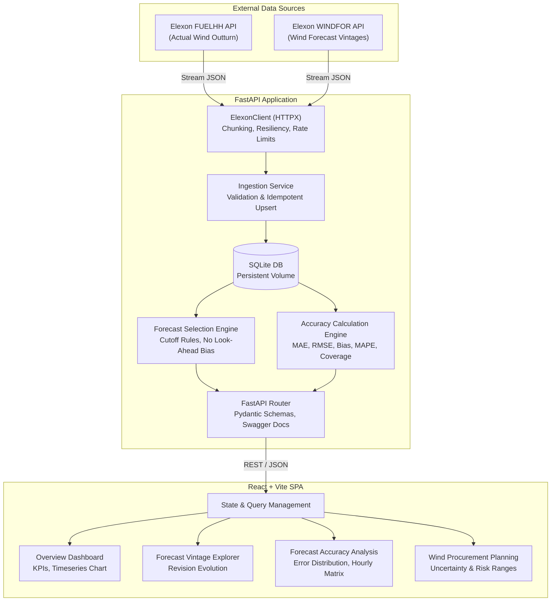

# System Architecture: Wind Procurement Intelligence

## 1. Executive Summary & Purpose

**Wind Procurement Intelligence** is a specialized analytical platform designed for a UK energy utility's electricity procurement team. Its mission is to quantify available national wind generation ahead of day-ahead power market auctions and bilateral procurement commitments, evaluate historical forecast reliability, and measure forecast error risk without look-ahead bias.

The system ingests authoritative outturn generation and forecast streams from the **Elexon BMRS (Balancing Mechanism Reporting System) / Insights Solution API**, normalizes timestamps and settlement intervals, models forecast revisions (vintages), applies day-ahead decision gate cutoffs, computes standardized forecast verification metrics (MAE, RMSE, Bias, MAPE), and delivers an interactive, decision-support dashboard in React.



---

## 2. System Architecture Layers

The platform follows a clean, decoupled 4-layer architecture:

### 2.0 Architectural Principles & Client Clarifications
Following Phase 0 review, the system architecture operates under eight strict domain invariants:
1. **Configurable Day-Ahead Decision Cutoff**: Defaults to `11:00 Europe/London` on $D-1$ as an operational model assumption. This must be confirmed with the client's trading desk and is fully parameterized at runtime.
2. **Strict Vintage Selection**: For each delivery interval, only the latest forecast published at or before the $D-1$ decision cutoff is eligible. Forecasts published after the cutoff are strictly barred when evaluating historical procurement decisions (zero look-ahead bias).
3. **Preservation of All Forecast Vintages**: Revisions published at earlier timestamps are permanently preserved in `forecast_generation`. New publications are inserted alongside existing vintages rather than overwriting them.
4. **Data Coverage Reporting**: Across January 2026, 1,488 half-hour settlement intervals are expected ($31 \text{ days} \times 48 \text{ SP}$). Expected intervals, retrieved actuals, eligible forecasts, matched pairs, missing actuals, and missing forecasts are tracked and reported separately.
5. **Timezone Awareness**: All internal comparisons and database records use UTC ISO 8601 timestamps. Europe/London is used strictly for business-facing delivery dates and decision cutoff boundaries.
6. **Explicit Boundary Enforcement**: Total electricity procurement requirements are NOT calculated; electricity demand, thermal generation scheduling, and wholesale power prices remain strictly outside the scope of this wind-only intelligence platform.
7. **Modular Decoupling**: API client (`ElexonClient`), ingestion engine, persistence repositories, vintage selector, verification engine, and FastAPI routes are completely decoupled.
8. **Automated Verification**: End-to-end integration and unit tests accompany each functional component.

### 2.1 Layer 1: Data Acquisition & Ingestion
- **Dedicated Elexon HTTP Client**: Implemented using `httpx.AsyncClient` with configurable base URL (`https://data.elexon.co.uk/bmrs/api/v1`), explicit request timeouts (30s), retries with exponential backoff for transient HTTP 429/500/503 errors.
- **Endpoint Adaptation**:
  - `FUELHH/stream`: Parameterized by `settlementDateFrom`, `settlementDateTo`, and filtered by `fuelType=WIND`.
  - `WINDFOR/stream`: Parameterized by `publishDateTimeFrom` and `publishDateTimeTo`. Because day-ahead forecasts for January 1st are issued on December 31st (and earlier), ingestion covers `2025-12-30T00:00:00Z` through `2026-02-01T00:00:00Z`.
- **Stream Ingestion Chunking**: Ingestion runs in windowed batches (e.g., 3-to-5 day chunks) to avoid long-lived connection timeouts and unbounded memory consumption.
- **Offline / Seeding Resiliency**: Built-in capability to populate the local database from pre-fetched Elexon JSON seed fixtures if internet access is restricted in container environments.

### 2.2 Layer 2: Persistence & Data Modeling (SQLite)
- **Database Engine**: SQLite 3 accessed via SQLAlchemy 2.0 ORM with asynchronous session management (`aiosqlite`).
- **Persistence**: Persisted on host storage using a Docker named volume (`sqlite_data`).
- **Normalized Tables**:
  - `actual_generation`: Unique constraint on `(delivery_timestamp, source)`. Stores settlement outturn in MW.
  - `forecast_generation`: Unique constraint on `(delivery_timestamp, publish_timestamp, source)`. Preserves every historical revision/vintage published by National Grid ESO.
  - `ingestion_log`: Audit trail tracking API ingestion runs, status, interval counts, and execution timestamps.
- **Indexes**: Composite B-tree indexes on `(delivery_timestamp)`, `(publish_timestamp)`, and `(delivery_date)` to guarantee sub-millisecond query responses for date-range and vintage slice queries.

### 2.3 Layer 3: Domain & Analytical Services
- **Forecast Selection Engine**:
  - Enforces the Day-Ahead Decision Rule: For delivery day $D$, decision occurs on $D-1$ at cutoff $T_{\text{cutoff}}$ (default 11:00 Europe/London).
  - Selects $\max(\text{publish\_timestamp})$ where $\text{publish\_timestamp} \le \text{cutoff\_timestamp}$ for each 30-minute delivery interval of day $D$.
  - Strictly rejects forecasts published after cutoff (prevents look-ahead bias).
  - Explicitly flags intervals where no forecast was published prior to cutoff as `MISSING_FORECAST` (no forward substitution).
- **Forecast Verification & Accuracy Engine**:
  - Vectorized interval-level difference calculation: $\text{error} = \text{forecast} - \text{actual}$.
  - Summary metrics: Mean Absolute Error (MAE), Root Mean Squared Error (RMSE), Forecast Bias, Mean Absolute Percentage Error (MAPE).
  - Safe MAPE Calculation: Divides only where $\text{actual} > 0$. Accurately tallies and exposes `excluded_zero_actual_count`.
  - Data Coverage Auditor: Tallies expected intervals ($48 \times \text{days}$), available actuals, available forecasts, matched pairs, missing actuals, and missing forecasts.

### 2.4 Layer 4: Presentation & UI (React Dashboard)
- **Framework**: React 18 SPA bundled with Vite for ultra-fast HMR and optimized production bundles.
- **Styling**: Tailwind CSS with an energy trading aesthetic (slate/dark palette, emerald/amber indicators, high contrast metrics).
- **Visualization**: Recharts for responsive, interactive timeseries charts, error distribution bar charts, and residual scatter plots.
- **Views**:
  1. **Overview Dashboard**: High-level KPIs (Daily Energy Forecast vs Actual, MAE, Bias, RMSE, Coverage %), 30-minute timeseries overlay, and date picker.
  2. **Forecast Analysis**: Visualizes forecast evolution across vintages (e.g. comparing 07:30 vs 09:30 vs 11:30 publication runs).
  3. **Forecast Accuracy**: Error distribution histograms, hourly error patterns, and over/under-forecast duration.
  4. **Procurement Planning**: Net wind availability, 90% confidence bands derived from historical errors, downside wind risk buffer.

---

## 3. Component Details & Directory Structure

```
wellfound-project/
├── backend/
│   ├── app/
│   │   ├── __init__.py
│   │   ├── main.py                    # FastAPI application initialization & middleware
│   │   ├── core/
│   │   │   ├── __init__.py
│   │   │   ├── config.py              # Pydantic BaseSettings (env configs)
│   │   │   ├── database.py            # SQLAlchemy engine, session maker, base model
│   │   │   └── timezone.py            # UK Europe/London & UTC conversion helpers
│   │   ├── models/
│   │   │   ├── __init__.py
│   │   │   ├── actual.py              # ActualGeneration ORM model
│   │   │   ├── forecast.py            # ForecastGeneration ORM model
│   │   │   └── audit.py               # IngestionLog ORM model
│   │   ├── schemas/
│   │   │   ├── __init__.py
│   │   │   ├── actual.py              # Actuals Pydantic schemas
│   │   │   ├── forecast.py            # Forecast & Vintage Pydantic schemas
│   │   │   ├── comparison.py          # Day-ahead matched comparison schemas
│   │   │   ├── analytics.py           # Verification & accuracy metrics schemas
│   │   │   └── health.py              # System health check schema
│   │   ├── clients/
│   │   │   ├── __init__.py
│   │   │   └── elexon_client.py       # Async HTTP client for Elexon BMRS
│   │   ├── services/
│   │   │   ├── __init__.py
│   │   │   ├── ingestion_service.py   # Ingestion, validation & DB upsert
│   │   │   ├── forecast_service.py    # Cutoff filtering & vintage selection
│   │   │   └── analytics_service.py   # Error metrics, MAPE & coverage audit
│   │   └── api/
│   │       ├── __init__.py
│   │       └── routes/
│   │           ├── __init__.py
│   │           ├── health.py          # GET /api/health
│   │           ├── actuals.py         # GET /api/actuals
│   │           ├── forecasts.py       # GET /api/forecasts
│   │           ├── vintages.py        # GET /api/forecast-vintages
│   │           ├── comparison.py      # GET /api/comparison
│   │           └── analytics.py       # GET /api/analytics
│   ├── tests/
│   │   ├── conftest.py                # Pytest fixtures & in-memory SQLite DB
│   │   ├── test_timezone.py           # Timezone & settlement period tests
│   │   ├── test_elexon_client.py      # Mocked API client tests
│   │   ├── test_ingestion.py          # Validation & persistence tests
│   │   ├── test_forecast_selection.py # Gate closure & look-ahead bias tests
│   │   ├── test_analytics.py          # MAE, RMSE, Bias, MAPE tests
│   │   └── test_api_routes.py         # FastAPI endpoint integration tests
│   ├── requirements.txt
│   ├── Dockerfile
│   └── run.py                         # Local development runner
├── frontend/
│   ├── src/
│   │   ├── assets/
│   │   ├── components/
│   │   │   ├── common/                # Header, Navbar, StatCard, LoadingSpinner, Alert
│   │   │   ├── charts/                # ForecastVsActualChart, ErrorDistributionChart
│   │   │   └── tables/                # IntervalDataTable, VintageListTable
│   │   ├── pages/
│   │   │   ├── DashboardOverview.jsx  # Main overview view
│   │   │   ├── ForecastAnalysis.jsx   # Vintage comparison view
│   │   │   ├── AccuracyAnalysis.jsx   # Detailed error & distribution analysis
│   │   │   └── ProcurementPlanning.jsx# Wind procurement risk view
│   │   ├── services/
│   │   │   └── api.js                 # Axios API client wrapper
│   │   ├── App.jsx
│   │   ├── main.jsx
│   │   └── index.css
│   ├── package.json
│   ├── vite.config.js
│   ├── tailwind.config.js
│   └── Dockerfile
├── docs/
│   ├── architecture.md                # (This document)
│   ├── domain_assumptions.md          # Market assumptions & mathematical rules
│   ├── data_dictionary.md             # Dataset fields, types & descriptions
│   ├── api_documentation.md           # API specification & endpoints
│   ├── testing_strategy.md            # Unit, integration & frontend test plan
│   └── presentation.md                # Client demonstration narrative
├── docker-compose.yml
├── .env.example
└── README.md
```

---

## 4. API Endpoints Specification

| Method | Endpoint | Query Parameters | Description |
|---|---|---|---|
| `GET` | `/api/health` | None | Service liveness, database connectivity, and data record count. |
| `GET` | `/api/actuals` | `start_date`, `end_date` | National wind outturn generation (MW) per 30-min settlement period. |
| `GET` | `/api/forecasts` | `delivery_date`, `publish_time` (optional) | Wind generation forecasts for delivery date, optionally filtered by specific publication time. |
| `GET` | `/api/forecast-vintages`| `delivery_date` | List of all distinct publication timestamps available for the delivery date. |
| `GET` | `/api/comparison` | `delivery_date`, `decision_cutoff` | Matched interval comparison between the day-ahead forecast (published $\le$ cutoff) and actual outturn. |
| `GET` | `/api/analytics` | `start_date`, `end_date`, `decision_cutoff` | Aggregate accuracy metrics (MAE, RMSE, Bias, MAPE), error distribution, and coverage audit. |

---

## 5. Security, Deployment, & Scalability Considerations

1. **Non-Root Execution**: Backend and frontend Docker containers run under dedicated unprivileged users (`appuser` / `nginx`).
2. **Persistence Volume**: SQLite database is stored in a named volume (`sqlite_data:/app/data`), preserving ingested datasets across container restarts.
3. **No Hardcoded Secrets**: Configuration is read from environment variables via Pydantic `BaseSettings`. Elexon Insights Solution requires no API key for public stream datasets.
4. **Idempotent Ingestion**: Re-running ingestion over already-stored date ranges updates or ignores duplicates without corrupting record counts.
5. **Separation of Concerns**: Ingestion and analytics are decoupled. Analytics queries run entirely against the indexed local database, ensuring zero runtime dependency on external Elexon API availability during user interactions.
